<div align="center">



# SonataDB: Встраиваемая Сверхбыстрая СУБД для Low-Latency Hybrid RAG
### *Научно-технический обзор архитектуры и механизмов аппаратной специализации*

[](https://en.cppreference.com/w/cpp/compiler_support)
[](https://github.com/)
[](https://github.com/)
[](https://opensource.org/licenses/MIT)

</div>

---

<table>
<tr>
<td>

##  1. Аннотация и Введение (Abstract & Introduction)

### Аннотация
Современные архитектуры генерации ответов с дополнением знаниями (**Retrieval-Augmented Generation, RAG**) сталкиваются с барьером задержек (Latency) при передаче векторов и текстов между процессами (Python/API) и внешними базами данных. Настоящая работа представляет **SonataDB** — высокопроизводительную, встраиваемую в процесс СУБД на языке C++20/23, реализующую гибридный поиск (векторный индекс HNSW и лексический индекс BM25) с локальным инференсом эмбеддинг-моделей. Архитектура SonataDB исключает накладные расходы на аллокацию памяти на горячих путях выполнения (**Zero-Allocation**) и предлагает глубокую аппаратную интеграцию с ОС и процессором через переносимые слои абстракций памяти, SIMD и сетевых вызовов.

### Введение
Традиционные СУБД проектируются с расчетом на универсальность, что приводит к избыточному копированию данных в пользовательском пространстве и неоптимальной утилизации процессорных кэшей L1/L2/L3 при поиске по многомерным графам. SonataDB реализует подход **Hardware-Software Co-Design** («от железа вверх»):
1. **Colocated Inference & Retrieval:** Эмбеддинги генерируются внутри адресного пространства БД с помощью встроенного ONNX Runtime и С++ реализаций BPE/WordPiece токенизаторов, устраняя сетевой и IPC-оверхед.
2. **Zero-Allocation Execution:** Использование абстракций `std::span` и `std::string_view` гарантирует бескопируемую передачу сырых данных на этапах токенизации, инференса и поиска.
3. **Кроссплатформенная системная переносимость:** Ядро БД абстрагировано от системных различий, обеспечивая одинаковую производительность и надежность как под управлением Windows API (Winsock, Win32 Memory Mapping), так и Linux (POSIX `mmap`, `io_uring`).

</td>
</tr>
</table>

---

<table>
<tr>
<td>

##  2. Математическая модель поиска (Retrieval Engine)

SonataDB объединяет лексическое распределение плотности термов и геометрическую близость векторов в общем конвейере слияния.

### 2.1 Векторный индекс HNSW (Hierarchical Navigable Small World)
Векторный поиск основан на многослойном графе вероятностных связей. Граф HNSW хранится в непрерывном файле, проецируемом через `MmapFile` (Zero-Copy Read).
- **Потокобезопасность:** Вставка новых узлов использует оптимистичные мелкогранулярные блокировки (Fine-Grained Spinlocks) ребер графа на уровне отдельных вершин, не блокируя конкурентные потоки чтения.
- **Tombstoning & Graph Compaction:** Удаление узлов происходит через маскирование в Roaring Bitmaps. Для предотвращения фрагментации и промахов кэша страниц фоновый поток асинхронно производит перестроение графа (Compaction) с атомарной подменой указателя (Pointer Swap).

### 2.2 Лексический индекс BM25
Лексический конвейер использует нормализацию слов (`libstemmer`) и инвертированный индекс с формулой оценки соответствия BM25:

$$RSV_D = \sum_{i=1}^{n} IDF(q_i) \cdot \frac{f(q_i, D) \cdot (k_1 + 1)}{f(q_i, D) + k_1 \cdot \left(1 - b + b \cdot \frac{|D|}{avgdl}\right)}$$

Для минимизации объема индекса на диске списки совпадений (Posting Lists) упаковываются с помощью сжатия **Elias-Fano** (монотонные последовательности) и кодирования переменной длины **Varint**.

### 2.3 Слияние результатов RRF (Reciprocal Rank Fusion)
Результаты HNSW и BM25 нормализуются с помощью алгоритма RRF, исключающего перекосы шкал мер близости:

$$RRF\_Score(d \in D) = \sum_{m \in M} \frac{1}{k + r_m(d)}$$

где $M$ — множество методов поиска, $r_m(d)$ — ранг документа $d$ в выдаче метода $m$, а константа регуляризации $k = 60$.

</td>
</tr>
</table>

---

<table>
<tr>
<td>

##  3. Аппаратная специализация и ML-инференс

### 3.1 Runtime SIMD Dispatcher
Для расчета мер близости векторов (Dot Product, L2 Distance, Cosine Similarity) SonataDB использует специализированный слой диспетчеризации. При инициализации приложения происходит опрос регистров процессора через CPUID:

$$\text{SIMD Pipeline} = \begin{cases} 
\text{AVX-512 FMA} & \text{при поддержке AVX-512F / AVX-512CD} \\
\text{AVX2 FMA} & \text{при поддержке AVX2 / FMA3} \\
\text{ARM NEON} & \text{на архитектурах AArch64} \\
\text{Scalar Fallback} & \text{базовые C++ концепты C++20} 
\end{cases}$$

### 3.2 Thread Affinity Pool
Пул инференса контролирует миграцию потоков по ядрам CPU для предотвращения сброса кэша инструкций (Cache Thrashing). На мобильных процессорах и микрокомпьютерах (например, Raspberry Pi 5 / ARM Big.LITTLE) планировщик автоматически выделяет производительные (Performance) ядра под обход графа HNSW, а энергоэффективные (Efficiency) ядра — под дисковый ввод-вывод.

### 3.3 Встроенные BPE & WordPiece Токенизаторы
Нативная C++ реализация токенизации по алгоритмам Byte-Pair Encoding и WordPiece позволяет парсить текст запроса в индексы токенов без вызова внешних библиотек на Python. Токенизатор считывает модель напрямую из формата HuggingFace `tokenizer.json` и оптимизирован с использованием плоских ассоциативных массивов для быстрого поиска подстрок.

</td>
</tr>
</table>

---

<table>
<tr>
<td>

##  4. Системный уровень хранения и Сетевой транспорт

### 4.1 Кроссплатформенная абстракция `MmapFile`
Класс `MmapFile` реализует тонкую обертку над подсистемами виртуальной памяти различных операционных систем:
- **POSIX API:** Использование `mmap`, `munmap`, `msync` и `madvise`.
- **Windows API:** Реализация на базе `CreateFileMappingW`, `MapViewOfFile`, `UnmapViewOfFile` и `FlushViewOfFile`.
Это обеспечивает прозрачную загрузку индексов размером в десятки гигабайт с автоматическим кэшированием страниц операционной системой.

### 4.2 Write-Ahead Log (WAL)
Для обеспечения транзакционной надежности все операции изменения данных пишутся в append-only лог (`WriteAheadLog`). Каждая запись WAL сериализуется со структурированным заголовком:

```cpp
#pragma pack(push, 1)
struct WalRecordHeader {
    uint8_t opcode;        // 1 - INSERT, 2 - UPDATE, 3 - DELETE
    uint32_t key_len;      // Длина ключа
    uint32_t payload_len;  // Длина полезной нагрузки
    uint32_t checksum;     // XOR контрольная сумма для валидации целостности
};
#pragma pack(pop)
```
Для сброса данных на диск на Windows используется системный вызов `FlushFileBuffers` (аналог `fsync` на POSIX-системах). Восстановление после сбоев (`recover`) считывает поток с использованием портативного `std::ifstream`.

### 4.3 Сетевой стек и бинарный протокол
Сетевой сервер (`TcpServer`) имеет две независимые реализации:
1. **Linux (io_uring):** Асинхронное ядро с фиксированными буферами ввода-вывода (Zero-Copy Ring Buffers), обеспечивающее пропускную способность, близкую к физическому лимиту сетевой карты.
2. **Windows/Fallback (Select):** Асинхронный событийный цикл на базе Winsock `select` с неблокирующими сокетами и минимальным интервалом опроса, гарантирующий стабильную работу в отладочных и тестовых средах Windows и macOS.

</td>
</tr>
</table>

---

<table>
<tr>
<td>

##  5. Сборка, Конфигурация и Тестирование

### Зависимости:
Проект использует менеджер пакетов `vcpkg` в режиме манифеста для автоматического разрешения зависимостей:
- `gtest` (тестирование)
- `benchmark` (бенчмарки производительности)
- `rocksdb` (хранение метаданных документов)
- `roaring` ( Roaring Bitmaps для масок удаления)
- `libstemmer` (стемминг текста)
- `nlohmann-json` (парсинг метаданных)
- `onnxruntime` (выполнение эмбеддинг-моделей)

### Сборка проекта (Release):
Для сборки под Windows используйте Visual Studio / MSBuild. Важно собирать проект в режиме **Release** (`-DCMAKE_BUILD_TYPE=Release`), чтобы исключить отладочные макросы валидации статических схем ONNX Runtime:

```powershell
# Создание директории сборки
mkdir build
cd build

# Конфигурация CMake с использованием vcpkg
cmake .. -DCMAKE_TOOLCHAIN_FILE="[Путь к вашему vcpkg.cmake]"

# Компиляция бинарников
cmake --build . --config Release
```

### Запуск тестов:
После успешной сборки запустите исполняемый файл тестов из директории сборки:
```powershell
cd tests
.\Release\sonatadb_tests.exe
```

Сводка тестов покрывает все математические операции, токенизаторы, индексы, WAL, сетевой протокол и встроенный инференс (всего 63 теста, включая сетевое Ping-Pong Winsock взаимодействие).

</td>
</tr>
</table>

---

<table>
<tr>
<td>

##  6. Структура Репозитория

- **`include/sonatadb/math/`**: Математическое ядро, интринсики AVX2/AVX-512, диспетчеризация SIMD.
- **`include/sonatadb/storage/`**: Файлы проекции памяти `MmapFile`, транзакционный лог `WriteAheadLog` и хранилище метаданных.
- **`include/sonatadb/index/`**: Реализация графа HNSW, сжатие Elias-Fano/Varint и алгоритмы лексического поиска BM25.
- **`include/sonatadb/network/`**: Заголовочные файлы сетевого сервера `TcpServer` и буферов `RingBuffer`.
- **`src/`**: Исходный код реализации всех компонентов системы.
- **`tests/`**: Набор юнит-тестов Google Test.
- **`benchmarks/`**: Тесты производительности Google Benchmark.

</td>
</tr>
</table>
