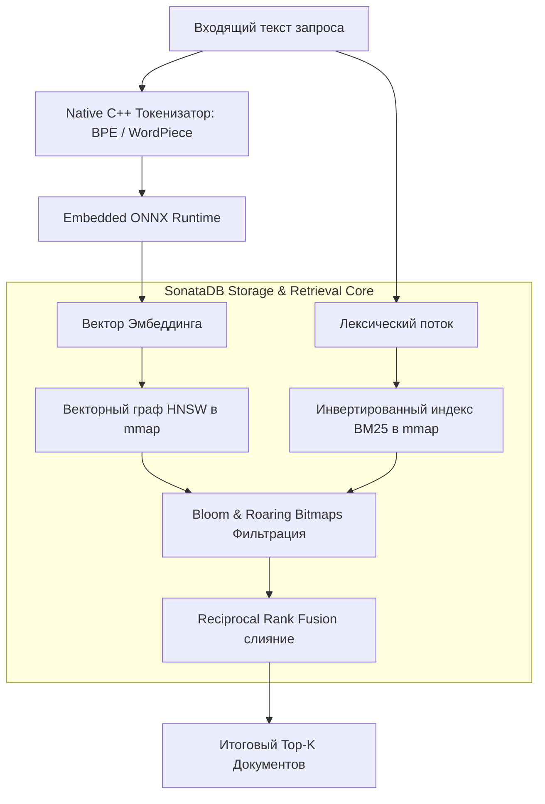

<div align="center">


# SonataDB: High-Performance Embedded Hybrid RAG Database

[](https://en.cppreference.com/w/cpp/compiler_support)
[](https://github.com/)
[](https://github.com/)
[](https://opensource.org/licenses/MIT)

**SonataDB** — это встраиваемая высокопроизводительная гибридная база данных и поисковый движок нового поколения, разработанный на C++20/23. Движок объединяет векторный поиск (HNSW) и классический полнотекстовый поиск (BM25) в единый конвейер слияния результатов (Reciprocal Rank Fusion, RRF) с нулевыми накладными расходами на межпроцессное взаимодействие (Zero-Allocation IPC). Разработан для сценариев Low-Latency RAG (Retrieval-Augmented Generation), граничных вычислений (Edge AI), а также высокопроизводительных облачных сервисов.

</div>

---

## 🔬 Научно-Архитектурная Концепция

Традиционные RAG-решения страдают от высокой латентности и джиттера из-за накладных расходов на передачу данных между Python-инфраструктурой моделей и внешними базами данных. **SonataDB переносит инференс эмбеддинг-моделей и конвейер гибридного поиска непосредственно в процесс выполнения приложения.**



Движок оптимизирован «от железа вверх» (Hardware-Software Co-design), обеспечивая максимальное использование системных ресурсов процессора, кэша и NVMe-накопителей.

---

## 🛠️ Ключевые Архитектурные Компоненты

### 1. Гибридный поисковый движок (Retrieval Engine)
* **Векторный граф HNSW:** 
  - Размещен в проекции виртуальной памяти (`mmap`), позволяя работать с базами данных размером более 100 ГБ без полной загрузки в RAM.
  - Потокобезопасная мелкогранулярная блокировка ребер графа (Fine-Grained Node Locking) во время параллельной вставки.
  - Поддержка удаления записей через битовые маски (**Tombstoning**) с последующим фоновым сжатием (Graph Compaction) в стиле LSM-деревьев.
* **Лексический индекс BM25:**
  - Встроенный стемминг слов на базе `libstemmer`.
  - Сжатие списков совпадений (Posting Lists) с использованием алгоритмов переменной длины Elias-Fano и Varint, обеспечивающих минимальный размер индекса на диске.
* **Reciprocal Rank Fusion (RRF):**
  - Математическое слияние результатов лексического и векторного поиска по формуле взаимного ранга, устойчивое к различным шкалам оценок (scores).

### 2. Встроенный AI-инференс (Embedded AI Pipeline)
* **Встраиваемый ONNX Runtime:**
  - Локальный инференс современных эмбеддинг-моделей (например, семейства `BGE`, `E5`) без сетевых запросов.
* **Zero-Dependency Токенизаторы:**
  - Native-реализации BPE (Byte-Pair Encoding) и WordPiece токенизаторов, совместимые с конфигурациями HuggingFace (`tokenizer.json`).
* **Пул потоков с привязкой к ядрам (Thread Affinity Pool):**
  - Поддержка привязки потоков к физическим ядрам процессора для минимизации миграции потоков и промахов L1/L2 кэша.
  - Поддержка гетерогенных архитектур (Big.LITTLE) — диспетчеризация вычислений на производительные (Performance) ядра, а записи WAL — на энергоэффективные (Efficiency) ядра.

### 3. Низкоуровневая подсистема хранения (Storage Layer)
* **Memory-Mapped I/O (`MmapFile`):**
  - Кроссплатформенная абстракция проецирования файлов: использование `mmap`/`munmap` на POSIX-системах и `CreateFileMapping`/`MapViewOfFile` на Windows API.
  - Интеграция системных подсказок `madvise` (`MADV_RANDOM` / `MADV_WILLNEED`) для управления системным кэшем страниц ОС.
* **Write-Ahead Log (WAL):**
  - Надежное append-only логирование всех операций записи с использованием Win32 API / POSIX `fsync` для предотвращения повреждения данных.
* **Хранилище метаданных:**
  - Интегрированный RocksDB в качестве K/V хранилища для индексации документов и JSON-атрибутов.

### 4. Аппаратная векторизация (Hardware Specialization)
* **Runtime SIMD Dispatcher:**
  - Автоматическое определение поддерживаемого набора инструкций процессора при запуске.
  - Математическое ядро поддерживает векторные вычисления L2, Cosine и Dot Product с использованием инструкций AVX-512, AVX2 (с FMA) и ARM NEON с безопасным программным фоллбеком на скалярные вычисления.

### 5. Сетевой транспорт (Network Layer)
* **Zero-Allocation Protocol:**
  - Бинарный кастомный TCP-протокол с минимальным оверхедом заголовков.
* **Кроссплатформенный сетевой движок:**
  - **Linux бэкенд:** Асинхронный сервер на системных вызовах `io_uring` с фиксированными буферами для достижения максимальной пропускной способности.
  - **Windows/Fallback бэкенд:** Портативный асинхронный сервер на базе неблокирующих сокетов и системного вызова `select`.

---

## ⚡ Характеристики Производительности

Движок разработан по методологии **Zero-Allocation**:
- Все операции чтения векторов и обхода графа HNSW происходят без выделения памяти на куче в горячем цикле.
- Передача текстовых данных и токенов осуществляется через `std::span` и `std::string_view` с предотвращением лишних копирований (Zero-Copy).
- Конструкция сетевого буфера на базе кольцевых массивов (`RingBuffer`) позволяет считывать сетевые пакеты прямо в память парсера протокола.

---

## 🛠️ Сборка и Установка

Для управления внешними зависимостями проект использует **vcpkg** в manifest-режиме.

### Требования к окружению:
- Компилятор с поддержкой C++20/23 (MSVC 2022 / Clang 16+ / GCC 13+)
- CMake версии 3.20 или выше
- Установленный Python 3.x (для генерации фиктивных тестовых моделей)

### Сборка под Windows (MSVC):
Рекомендуется использовать конфигурацию **Release** для тестов и продакшена, чтобы избежать отладочных проверок статической регистрации ONNX:

```powershell
# Создание директории сборки
mkdir build
cd build

# Конфигурация CMake с vcpkg
cmake .. -DCMAKE_TOOLCHAIN_FILE="C:/Program Files/Microsoft Visual Studio/2022/Community/VC/vcpkg/scripts/buildsystems/vcpkg.cmake"

# Сборка проекта в режиме Release
cmake --build . --config Release
```

### Сборка под Linux (Clang/GCC):
```bash
mkdir build && cd build
cmake .. -DCMAKE_TOOLCHAIN_FILE="/path/to/vcpkg/scripts/buildsystems/vcpkg.cmake" -DCMAKE_BUILD_TYPE=Release
make -j$(nproc)
```

---

## 🧪 Запуск Тестов и Бенчмарков

### Юнит-тесты
Тестовый комплект SonataDB покрывает все математические операции, индексы, WAL, сетевой протокол и встроенный инференс.

Запустите тесты из директории сборки:
```bash
cd build/tests
# Windows
.\Release\sonatadb_tests.exe
# Linux
./Release/sonatadb_tests
```

*Примечание:* Для полноценного тестирования AVX-512 инструкций на хост-системах без аппаратной поддержки используйте Intel Software Development Emulator (SDE):
```bash
/path/to/sde64 -skx -- ./build/tests/sonatadb_tests
```

### Бенчмарки производительности
Для оценки пропускной способности вычислений и времени отклика индексов:
```bash
cd build/benchmarks
# Windows
.\Release\sonatadb_benchmarks.exe
# Linux
./Release/sonatadb_benchmarks
```

---

## 📂 Структура Исходного Кода

```text
├── include/sonatadb/
│   ├── c_api/         # Плоский C-интерфейс (extern "C") для FFI биндингов
│   ├── compression/   # Elias-Fano, Varint сжатие списков BM25
│   ├── index/         # Граф HNSW, BM25, фильтры Bloom & Roaring
│   ├── inference/     # ONNX Runner, Пул потоков, Affinity Manager
│   ├── math/          # SIMD абстракции, интринсики AVX2/512
│   ├── network/       # Сетевой сервер (io_uring / Winsock)
│   ├── storage/       # MmapFile, WAL, RocksDB Metadata Store
│   └── text/          # BPE & WordPiece токенизаторы
├── src/               # Реализация C++ исходных файлов
├── tests/             # Google Test юнит-тесты
└── benchmarks/        # Google Benchmark тесты производительности
```

---

## 📜 Лицензия

Проект распространяется под открытой лицензией MIT. Подробнее см. в файле [LICENSE](./LICENSE) (при наличии).
